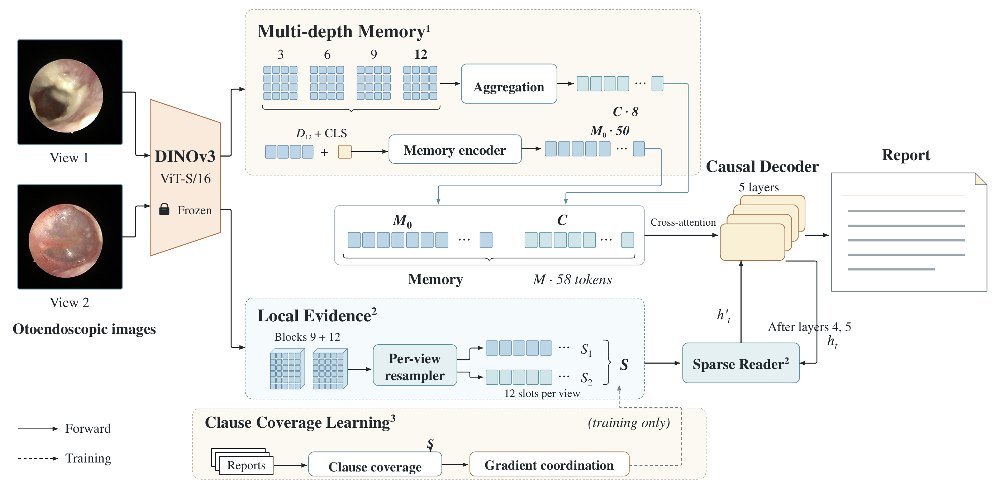

# OtoEvi

### Local Evidence-Guided Otoendoscopic Report Generation

**Multi-depth Visual Memory · View-preserving Sparse Reading · Clause Coverage Learning**

[简体中文](README.zh-CN.md) · [Installation & reproduction](docs/reproducibility.md) · [Data preparation](docs/data.md) · [Paper-to-code map](docs/paper_to_code.md) · [Results](results/README.md) · [Computational cost](docs/computational_cost.md)

OtoEvi generates an examination-level report from one or two images. A frozen DINOv3 encoder supplies a compact multi-depth memory and separate view-specific local slots. The decoder reads those slots while generating text; **Clause Coverage Learning (CCL)** trains the same slots using distinct positive clauses from the paired report, without region annotations.

Official PyTorch implementation of **OtoEvi: Local Evidence-Guided Otoendoscopic Report Generation**. The default `full` configuration combines **multi-depth visual memory, view-preserving sparse reading and CCL**.

## What is included

- Installable PyTorch package with training, image-only prediction and evaluation CLIs.
- All eight memory / reading / CCL factorial configurations and a gradient-coordination control.
- Fixed configurations, public-dataset split reconstruction, corpus metrics and the frozen ten-concept Chinese reference-agreement evaluator.
- Three-seed aggregate and per-seed results, unit tests and synthetic integration tests.

**Data availability:** to protect patient privacy and confidential clinical information, the OtoInsight dataset, including individual examination images and clinical reports, is not publicly available at this time. The repository includes the illustrative images in the paper’s overview figure and fictional data-format examples. IU X-Ray and PEIR Gross images and source captions should be obtained from their original or authorized providers. See [availability and dataset protocols](docs/data.md).

**Model weights:** trained report-generation checkpoints are not included in the current release. Generic DINOv3 weights are available from their upstream provider under its own terms.

## Method



**Figure 1. OtoEvi overview.** The 58-token memory supplies every decoder layer. A separate path forms 12 local slots per real view; independent sparse readers update the outputs of layers four and five. Clause coverage and gradient coordination operate only during training. Backbone block numbers are one-based.

| Paper component | Implementation | Key settings |
|---|---|---|
| Multi-depth Visual Memory | [`models/memory.py`](src/otoevi/models/memory.py) | Backbone blocks 3/6/9/12; 7×7 grids; top 24 tokens per depth; 58 memory tokens |
| View-preserving Sparse Reading | [`models/evidence.py`](src/otoevi/models/evidence.py) | Native grids from blocks 9/12; 12 slots/view; four-head sparsemax readers |
| Clause Coverage Learning | [`training/alignment.py`](src/otoevi/training/alignment.py) | Equal weight per distinct positive clause; pooled reverse loss; temperature 0.07 |
| Gradient coordination | [`training/gradients.py`](src/otoevi/training/gradients.py) | Per-examination conflict projection; auxiliary norm limit of 0.5× main norm |

The objective is `L = Lgen + 0.05 Lreport + 0.015 Lclause`. Coverage deduplicates the forward positive average only; repeated allowed instances remain in the denominator and reverse objective. The [equation map](docs/paper_to_code.md) documents the exact correspondence.

## Results

Mean ± **sample standard deviation** over seeds **42, 7, 3407**, using the final checkpoint after 15 epochs. BLEU and ROUGE-L are percentages; CIDEr is unscaled.

| Dataset / evaluated partition | BLEU-1 | BLEU-2 | BLEU-3 | BLEU-4 | ROUGE-L | CIDEr |
|---|---:|---:|---:|---:|---:|---:|
| OtoInsight validation (1,583) | 77.78 ± 0.33 | 73.65 ± 0.29 | 70.11 ± 0.26 | 66.76 ± 0.22 | 77.05 ± 0.14 | 3.958 ± 0.029 |
| IU X-Ray test (383) | 41.87 ± 0.06 | 25.37 ± 0.24 | 17.12 ± 0.27 | 12.28 ± 0.30 | 32.66 ± 0.31 | 0.311 ± 0.010 |
| PEIR Gross revised test (745) | 53.43 ± 0.14 | 46.14 ± 0.15 | 40.52 ± 0.09 | 35.90 ± 0.05 | 53.63 ± 0.32 | 1.083 ± 0.029 |

On OtoInsight validation, concept Macro-F1 is **46.11 ± 1.66%** and Micro-F1 is **62.74 ± 0.65%**. These are fixed-rule agreement measures, not clinician-adjudicated accuracy. Adding CCL to memory + reading raises mean BLEU-4 from **66.45% to 66.76%**; effects in other factorial combinations are mixed. Full results, paired comparisons and limitations are described in [results/README.md](results/README.md).

OtoInsight results use the validation partition. IU X-Ray and PEIR Gross models are trained and evaluated separately on each dataset. PEIR uses the study-specific split and history-reduced references described in the [data protocol](docs/data.md#peir-gross-protocol); comparisons require the same split and reference protocol.

## Installation

Validated research environment: Python **3.8.19**, PyTorch **2.3.1 + CUDA 12.1**, torchvision **0.18.1**, timm **1.0.27**, Linux / NVIDIA RTX 4090. Dependencies are pinned in `pyproject.toml`; supported Python range is 3.8–3.11.

```bash
git clone https://github.com/lululualululu/OtoEvi.git
cd OtoEvi
python -m venv .venv
source .venv/bin/activate
python -m pip install --upgrade pip
python -m pip install torch==2.3.1 torchvision==0.18.1 --index-url https://download.pytorch.org/whl/cu121
python -m pip install -e ".[eval]"
```

Obtain the **timm-format** [`vit_small_patch16_dinov3.lvd1689m`](https://huggingface.co/timm/vit_small_patch16_dinov3.lvd1689m) `model.safetensors`, following the provider's access and license terms. Place it at `weights/dinov3/model.safetensors` or pass an explicit path. The study used upstream revision `3bf4720a82ec2066db88137180ff1f83a675cef0` and SHA-256:

```text
2a1ec16ae28ffa07bc0ead0241ee7df9fc26451fe6f9f839b7b3afa0a906b040
```

## Prepare data

Each manifest is a JSON list of examinations, with a report and ordered image filenames. The following is a **fictional schema example**:

```json
[
  {
    "report_id": "example-001",
    "patient_id": "example-patient-001",
    "filenames": ["example-view-1.png", "example-view-2.png"],
    "caption": "左侧鼓膜完整。"
  }
]
```

Split OtoInsight by patient before augmentation. The loader uses the first two real views and masks missing views; it does not fabricate a second image. See [docs/data.md](docs/data.md) for the complete schema and the fixed IU/PEIR reconstruction commands. Do not replace the study's supplied split lists with a random split when comparing with its tables.

## Train

Edit paths in `configs/otoinsight.json`, then run:

```bash
otoevi-train --config configs/otoinsight.json
```

For the three seeds:

```bash
for seed in 42 7 3407; do
  otoevi-train --config configs/otoinsight.json --seed "$seed" \
    --output "runs/otoinsight/full/seed${seed}"
done
```

Use `configs/iu_xray.json` or `configs/peir_gross.json` for the corresponding separately trained model. One process uses one GPU. Independent runs can be distributed over GPUs with `--device cuda:0` / `--device cuda:1`; this is not distributed training of one model.

Training uses 15 complete epochs, microbatch 32, effective batch 64, AdamW at 2e-4, one warm-up epoch, cosine decay and BF16 on CUDA. The final checkpoint is saved as `last_model.pt`; validation loss does not select a checkpoint. Resume with the same command plus `--resume`.

## Predict and evaluate

After training:

```bash
otoevi-predict \
  --checkpoint runs/otoinsight/full/seed42/last_model.pt \
  --vision-checkpoint weights/dinov3/model.safetensors \
  --images data/otoinsight/images/example-view-1.png \
           data/otoinsight/images/example-view-2.png \
  --device cuda:0
```

```bash
otoevi-evaluate \
  --checkpoint runs/otoinsight/full/seed42/last_model.pt \
  --vision-checkpoint weights/dinov3/model.safetensors \
  --manifest data/otoinsight/val.json --train data/otoinsight/train.json \
  --image-root data/otoinsight/images \
  --output runs/otoinsight/full/seed42/evaluation \
  --modes matched shuffled blank --device cuda:0
```

Evaluation saves complete per-report predictions locally and corpus BLEU-1/2/3/4, ROUGE-L and CIDEr. Chinese reports additionally receive concept, explicit-negative and laterality measures. Predictions are generated solely from images, view masks and fixed boundary tokens. The evaluator never passes reference reports or report IDs into the network.

For a tiny synthetic end-to-end check with your DINOv3 weights:

```bash
DINOV3_CHECKPOINT=weights/dinov3/model.safetensors \
  python -m unittest discover -s tests/integration -v
```

This tests the pipeline, not clinical performance. Unit tests need no downloaded weights:

```bash
python -m unittest discover -s tests/unit -v
```

## Ablations

| CLI `--variant` | Memory (A) | Sparse reading (B) | CCL |
|---|:---:|:---:|:---:|
| `base` | | | |
| `memory_only` | ✓ | | |
| `reading_only` | | ✓ | |
| `coverage_only` | | | ✓ |
| `memory_reading` | ✓ | ✓ | |
| `memory_coverage` | ✓ | | ✓ |
| `reading_coverage` | | ✓ | ✓ |
| `full` | ✓ | ✓ | ✓ |

Without A, one projected global token replaces the full memory. CCL without B retains the local slot carrier **during training only**; it is absent from generation. `no_gradient_coordination` retains the full model and CCL but uses ordinary backpropagation; results for this control are not included in the tables. See [ablation definitions](docs/paper_to_code.md).

## Repository layout

```text
OtoEvi/
├── configs/               # Dataset recipes and fixed public split specifications
├── src/otoevi/
│   ├── models/            # DINOv3, visual memory, slots, sparse reading
│   ├── training/          # CCL, report objective, gradient coordination, engine
│   ├── data/              # Manifests, tokenization, clauses, transforms
│   ├── inference/         # Strict checkpoint loading and image-only prediction
│   ├── evaluation/        # Corpus scores and ten-concept reference agreement
│   └── cli/               # train / predict / evaluate entry points
├── scripts/               # Public-data reconstruction and result checks
├── tests/                 # Unit and synthetic end-to-end tests
├── examples/              # Fictional manifest examples
├── results/               # Aggregate/per-seed metrics and evaluation settings
└── docs/                  # Reproduction, data protocol and paper correspondence
```

## Citation

If you use OtoEvi in your research, please cite:

```bibtex
@misc{xu2026otoevi,
  title  = {OtoEvi: Local Evidence-Guided Otoendoscopic Report Generation},
  author = {Xu, Nanbo and Lu, Zhengyang and Xu, Yanhong and Mao, Jiayang and
            Wu, Yunhan and Li, Huan and Liu, Min and Shu, Can and Zhou, Shengxiang and
            Yang, Juping and Li, Jun and Liu, Qiurui},
  year   = {2026},
  note   = {Manuscript},
  url    = {https://github.com/lululualululu/OtoEvi}
}
```

## License and acknowledgments

Original OtoEvi code is released under the [MIT License](LICENSE). Dependencies, datasets and pretrained weights retain their own terms; see [THIRD_PARTY_NOTICES.md](THIRD_PARTY_NOTICES.md). We use PyTorch, timm/DINOv3 and the COCO caption evaluation tools.

Please use GitHub Issues for reproducibility questions. Include the configuration, seed, dependency versions and a minimal synthetic example; do not post patient data.
