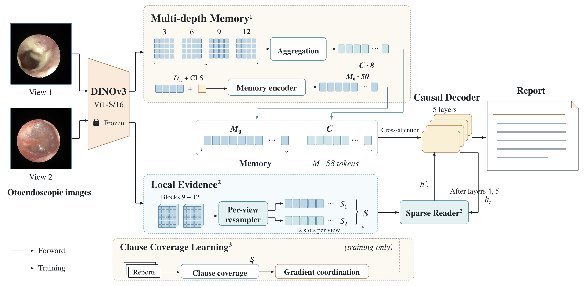

# OtoEvi：局部证据引导的耳内镜报告生成

[English](README.md) · [论文与代码对应](docs/paper_to_code.md) · [数据准备](docs/data.md) · [复现说明](docs/reproducibility.md)

本仓库公开 2026-11-03 稿件的最终实现：**多深度视觉记忆 + 保留视图的稀疏读取 + 子句覆盖学习（CCL）**。CCL 在历史实验中称为 D1；它与记忆中的 8 个视觉 C token 是两个不同概念。

模型使用冻结 DINOv3，从一至两幅检查图像生成报告。58 个记忆 token 提供检查级上下文，每个真实视图保留 12 个局部槽，解码器在第四、第五层后读取这些槽。训练时，每个不同正子句在前向覆盖目标中获得相同权重，反向目标保留正例概率聚合，并在局部槽处协调梯度。推理仅使用图像和有效视图掩码。

## 发布内容

提供可安装 Python 包、训练/推理/评估命令、八组 A/B/CCL 消融、三个数据集配置、IU/PEIR 固定划分重建工具、三种子汇总与逐种子指标、测试及论文公式对应表。

**完整 OtoInsight 数据集和训练检查点不在本次发布中。** 除论文框架图中的展示图像外，仓库不分发临床图像或逐病例临床报告；数据格式示例均为虚构。DINOv3 通用预训练权重需从上游自行获取，遵守其许可证。

## 方法框架



图 1 直接取自 2026-11-03 稿件。58 个记忆 token 为每层解码器提供信息；局部分支为每个真实视图保留 12 个槽，第四、第五层后的独立稀疏读取器读取局部证据。子句覆盖学习与梯度协调仅用于训练。

## 快速开始

安装方式与依赖版本见 [英文 README](README.md#installation)。配置文件中路径相对于命令执行目录；请在仓库根目录运行，并修改数据和权重路径。

```bash
python -m pip install -e ".[eval]"
otoevi-train --config configs/otoinsight.json
```

默认训练 15 轮、microbatch 32、有效 batch 64，保存最后一轮。种子为 42、7、3407；使用 `--seed` 和 `--output` 分开各次运行。切换 `configs/iu_xray.json` 或 `configs/peir_gross.json` 可在对应数据集单独训练。

英文 README 提供完整的预测、评估、三种子运行与消融命令。通过 `--device cuda:0` / `cuda:1` 可把独立实验分配至不同显卡。

## 指标口径

| 数据集及分区 | BLEU-4（%） | ROUGE-L（%） | CIDEr |
|---|---:|---:|---:|
| OtoInsight 验证集，1,583 份报告 | 66.76 ± 0.22 | 77.05 ± 0.14 | 3.958 ± 0.029 |
| IU X-Ray 测试集，383 份报告 | 12.28 ± 0.30 | 32.66 ± 0.31 | 0.311 ± 0.010 |
| PEIR 修订协议测试集，745 份报告 | 35.90 ± 0.05 | 53.63 ± 0.32 | 1.083 ± 0.029 |

均为三种子的均值 ± 样本标准差。OtoInsight 概念 Macro-F1 为 46.11 ± 1.66%，Micro-F1 为 62.74 ± 0.65%。这些指标衡量固定规则下的参考一致性，不等同于医生判定的临床准确性。

OtoInsight 此处为验证集结果，不能写成最终 CCL 的 2026 时间外测试结果。IU/PEIR 各自重新训练，不是耳内镜模型的零样本泛化。PEIR 使用本研究修订划分及病史削减参考，不是官方更正版本，不能与其他协议得分直接混比。完整原始参考的评分也保存在结果文件中。

## 与论文的对应及迁移验证

最终发布代码来自归档研究提交 `e4d0f8e` 对应的机制。此前旧仓库中 `src/otoevi` 的旧语义分支已不再执行；历史构造顺序仅用于保持初始化随机数一致，构造后删除闲置参数。迁移验证包括权重初始化、损失、加权梯度、数据处理、已训练模型输出和评估器。

稿件中的代码可用性地址及附录 S1.6 仍指向旧私有仓库和旧打包接口，需要更新为本公开仓库。具体替换文字见 [论文对应文档](docs/paper_to_code.md#manuscript-availability-update)。本次没有修改用户提供的 PDF。

## 许可

自有代码采用 [MIT](LICENSE)，允许学术和商业使用。第三方依赖、数据及预训练权重仍受各自条款约束。引用信息见英文 README。
